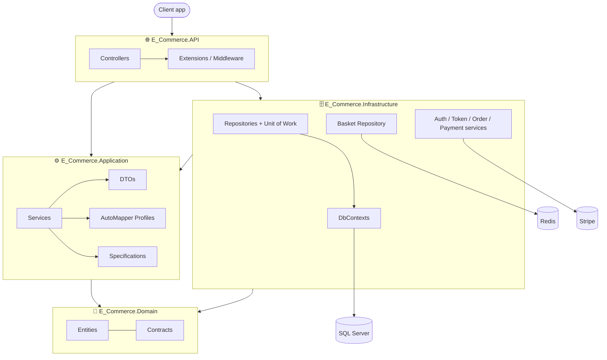

<div align="center">

# 🛒 E-Commerce API

**A RESTful e-commerce backend in ASP.NET Core 8, built with Clean Architecture: products, Redis basket, JWT identity, orders and Stripe payments.**


</div>

---

## 📑 Table of Contents

- [Overview](#-overview)
- [Features](#-features)
- [Tech Stack](#-tech-stack)
- [Architecture](#-architecture)
- [API Endpoints](#-api-endpoints)
- [Project Structure](#-project-structure)
- [Getting Started](#-getting-started)
- [Learning Journey](#-learning-journey)
- [Author](#-author)

---

## 🌟 Overview

**E-Commerce API** is the backend for an online store. It exposes REST endpoints for the product catalog, shopping basket, customer accounts, orders and payments, so any frontend (Angular, React, mobile) can use it.

The project was built step by step, one module per session. All session branches are merged into **`main`**, which holds the complete project. The branches are kept so you can see each stage. See [Learning Journey](#-learning-journey).

---

## ✨ Features

| Module | What it does |
|---|---|
| 🛍️ **Products** | List products, get one by id, list brands and types; filtering, searching, sorting and pagination through the **Specification pattern** |
| 🧺 **Basket** | Customer basket stored in **Redis** (create/update, get, delete) |
| 🔐 **Identity** | Register, log in, check if an email exists, get the current user, get/update address; secured with **JWT** |
| 📦 **Orders** | Create an order from a basket, list my orders, get one order, list delivery methods |
| 💳 **Payments** | Create or update a **Stripe** payment intent for a basket |

**Under the hood**

- ✅ **Clean Architecture** (Domain, Application, Infrastructure, API)
- ✅ Generic Repository + **Unit of Work**
- ✅ **Specification pattern** for reusable queries
- ✅ **Result pattern** for consistent responses and errors
- ✅ **AutoMapper** with a custom resolver for full picture URLs
- ✅ **Automatic migrations and data seeding** on startup (brands, types, products, delivery methods, roles and admin user)
- ✅ Separate **Identity database**
- ✅ **Swagger** documentation

---

## 🛠 Tech Stack

| Layer | Technology |
|---|---|
| **Framework** | .NET 8, ASP.NET Core Web API |
| **ORM** | Entity Framework Core 8 (Code-First + Migrations) |
| **Database** | SQL Server (store + identity) |
| **Cache** | Redis (`StackExchange.Redis`) for the basket |
| **Auth** | ASP.NET Core Identity + JWT Bearer |
| **Payments** | Stripe (`Stripe.net`) |
| **Mapping** | AutoMapper |
| **Docs** | Swagger (Swashbuckle) |

---

## 🏛 Architecture



---

## 🔌 API Endpoints

All routes start with `/api`. 🔒 means a JWT token is required.

<details open>
<summary><b>Products</b>: <code>/api/Product</code></summary>

| Method | Route | Description |
|---|---|---|
| GET | `/api/Product` | List products (filter, search, sort, paginate) |
| GET | `/api/Product/{id}` | Get one product |
| GET | `/api/Product/Brands` | List brands |
| GET | `/api/Product/Types` | List types |

</details>

<details>
<summary><b>Basket</b>: <code>/api/Baskets</code></summary>

| Method | Route | Description |
|---|---|---|
| GET | `/api/Baskets` | Get a basket |
| POST | `/api/Baskets` | Create or update a basket |
| DELETE | `/api/Baskets` | Delete a basket |

</details>

<details>
<summary><b>Authentication</b>: <code>/api/Authentication</code></summary>

| Method | Route | Description |
|---|---|---|
| POST | `/api/Authentication/Login` | Log in and get a token |
| POST | `/api/Authentication/Register` | Create an account |
| GET | `/api/Authentication/emailexists` | Check if an email is taken |
| GET 🔒 | `/api/Authentication/CurrentUser` | Get the logged-in user |
| GET 🔒 | `/api/Authentication/Address` | Get my address |
| PUT 🔒 | `/api/Authentication/Address` | Update my address |

</details>

<details>
<summary><b>Orders</b>: <code>/api/Orders</code> 🔒</summary>

| Method | Route | Description |
|---|---|---|
| POST | `/api/Orders` | Create an order |
| GET | `/api/Orders` | List my orders |
| GET | `/api/Orders/{id}` | Get one order |
| GET | `/api/Orders/deliveryMethods` | List delivery methods |

</details>

<details>
<summary><b>Payments</b>: <code>/api/Payment</code> 🔒</summary>

| Method | Route | Description |
|---|---|---|
| POST | `/api/Payment/{basketId}` | Create or update the Stripe payment intent |

</details>

---

## 📂 Project Structure

```
E_Commerce/
├── E_Commerce.slnx
│
├── E_Commerce.API/                     # 🌐 Presentation
│   ├── Controllers/                    # Product, Baskets, Authentication, Orders, Payment
│   ├── Extensions/                     # Identity/JWT setup, startup migrations + seeding
│   ├── Files/Images/Products/          # Product images (served at /Files)
│   └── Program.cs
│
├── E_Commerce.Application/             # ⚙️ Use cases
│   ├── Common/                         # Results, Errors, QueryParams
│   ├── DTOs/                           # Basket, Identity, OrderModule, Products
│   ├── Profiles/                       # AutoMapper profiles + PictureUrlResolver
│   ├── Services/
│   │   ├── Contracts/                  # IProductService, IBasketService, IOrderService, IPaymentService, ...
│   │   └── Implementation/             # ProductService, BasketService
│   └── Specification/                  # Product and order specifications
│
├── E_Commerce.Domain/                  # 🧩 Entities and contracts (no dependencies)
│   ├── Contracts/                      # IGenericRepository, IUnitOfWork, IBasketRepository, ISpecification, IDataSeeder
│   └── Models/                         # Products, Basket, Identity, OrderModule
│
└── E_Commerce.Infrastructure/          # 🗄️ Data access and external services
    ├── Data/
    │   ├── Configurations/             # Fluent API configurations
    │   ├── Context/                    # StoreDbContext, StoreIdentityDbContext
    │   └── Migrations/                 # Store migrations (+ Identity/ for the identity database)
    ├── DataSeeding/                    # DataSeeder, IdentityDataSeeder, SeedData/*.json
    ├── Repositories/                   # GenericRepository, UnitOfWork, BasketRepository (Redis)
    ├── Services/                       # Authentication, Token, Order, Payment (Stripe)
    └── Specifications/                 # SpecificationEvaluator
```

---

## 🚀 Getting Started

### Prerequisites

- [.NET 8 SDK](https://dotnet.microsoft.com/download/dotnet/8.0)
- SQL Server
- Redis, e.g. `docker run -d -p 6379:6379 redis`
- A [Stripe](https://stripe.com) test account (for payments)

### Run

1. **Clone the repository**
   ```bash
   git clone https://github.com/ahmedramzyelsheikh/E_Commerce.git
   cd E_Commerce
   ```

2. **Configure `E_Commerce.API/appsettings.json`**

   | Setting | What to put |
   |---|---|
   | `ConnectionStrings:DefaultConnection` | Store database |
   | `ConnectionStrings:IdentityConnection` | Identity database |
   | `ConnectionStrings:Redis` | e.g. `localhost:6379` |
   | `Token:Key` | A secret of **at least 64 characters** (required by HMAC-SHA512) |
   | `StripeSettings:SecretKey` / `PublishableKey` | Your Stripe **test** keys |

3. **Run the API**
   ```bash
   dotnet run --project E_Commerce.API
   ```

   On startup the API automatically:
   - applies the migrations for **both** databases
   - seeds brands, types, products and delivery methods from `Infrastructure/DataSeeding/SeedData`
   - creates the `Admin` and `SuperAdmin` roles and a default admin user (see `IdentityDataSeeder`)

4. Open **Swagger** at `http://localhost:5129/swagger`.

### Typical flow

1. `POST /api/Authentication/Register` or `Login` → copy the token
2. `POST /api/Baskets` with product ids and quantities
3. `POST /api/Payment/{basketId}` → creates the Stripe payment intent
4. `POST /api/Orders` with the basket id, delivery method and address

### Adding migrations

```bash
# store database
dotnet ef migrations add <Name> --context StoreDbContext \
  --project E_Commerce.Infrastructure --startup-project E_Commerce.API -o Data/Migrations

# identity database
dotnet ef migrations add <Name> --context StoreIdentityDbContext \
  --project E_Commerce.Infrastructure --startup-project E_Commerce.API -o Data/Migrations/Identity
```

---

## 🧭 Learning Journey

Each branch adds one module on top of the previous one. All of them are merged into `main`:

| Branch | Milestone |
|---|---|
| *sessions 1–2* | 🏗️ Clean Architecture setup + Products module (repository, unit of work, seeding, Result pattern) |
| `session-03API` | 🔎 Specification pattern + picture URL resolver |
| `session-04` | 🧺 Basket module with **Redis** + sorting and pagination specifications |
| `session-05` | 🔐 **Identity**: register, login, JWT, address |
| `session-07` | 📦 **Orders** module with delivery methods |
| `session-08` | 💳 **Stripe payments** |
| **`main`** | ✅ **Complete project**: all sessions merged, plus seed data, startup seeding and cleanup fixes |

---

## 👨‍💻 Author

<div align="center">

**Ahmed Ramzy**

[](https://github.com/ahmedramzyelsheikh)

⭐ If you like this project, give it a star!

</div>
